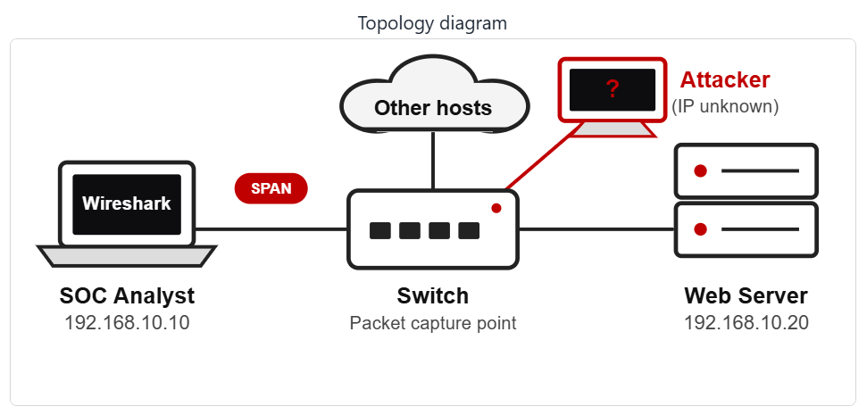
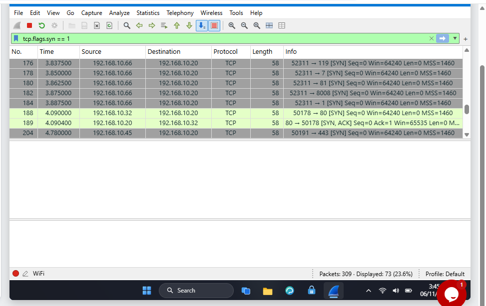
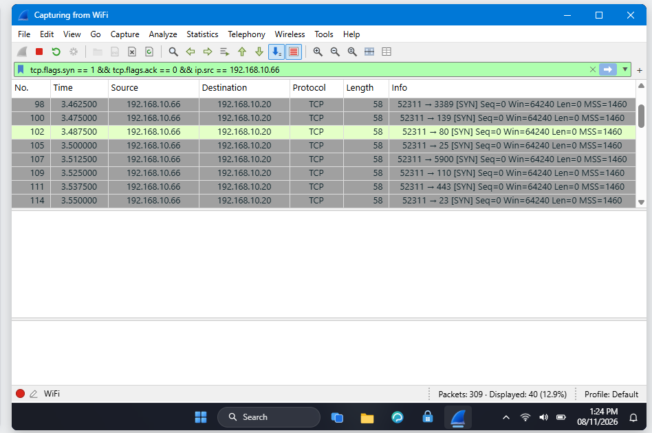

<div align="center">

# 🔐 Cybersecurity - SOC PROJECT - MODULE WIRESHARK (EXTRA)

**🔴 Find an attacker 🔴 Follow TCP Stream 🔴 Hidden data 🔴 Clear text passwords 🔴 Brute force 🔴 VoIP calls**
</div>

<p align="center">
  
  
  
  
  
  
  
  
  
  
  
  
  
  
</p>

---

## 📌 Project Overview

This is a Security Operations Center (SOC) project subdivided in 6 wireshark-lab activities. 


As a SOC analyst in this project, we will investigate 6 live labs. Each lab allows to capture network packets using Wireshark.

We will put into action skills such as Network analysis, Packet inspection, Protocol analysis, Protocol Hierarchy, VoIP, Security mindset, Critical and Analytical thinking, to identify an attacker, follow TCP Stream, rebuid a conversation and read what was sent, find hidden data, usernames, passwords, analyze a VoIP call paquets, play back the call and identify the scammer.

---


## 🎯 Objectives

The main objectives of this project are to:

- To identify the Attacker's IP
- Follow TCP Stream
- Rebuid a conversation and read what was sent
- Find the hidden data
- Find usernames and passwords sent in clear text over HTTP
- Spot the repeated login attempts and find who is guessing passwords (Brut Force Attacker)
- Investigate the capture, play the call and identify the scammer (VoIP call scammer)

---

## 🛡️ Purpose of the Lab

The project provides isolated and controlled environment through the 6 wireshark-labs for Network security learning, SOC skills gaining and authorized Network analysis practices.

It helps gain skills through practical activities :

- Network security
- Wireshark tools
- Packet inspection and analysis
- Protocol Hierarchy
- Protocol analysis
- Follow TCP Stream
- VoIP calls
- Intrusion Detection/Prevention (IDS/IPS)
- Digital Forensics
- Cyber Threat Intelligence (Threat Hunting/Detection/Attribution)
- Critical and Analytical thinking
- Security mindset
- Security-tool experimentation

---

## 🏗️ Lab Architecture




All the 6 labs are based on this topology diagram.

---

# 👁️‍🗨️ Wireshark Lab 3 - Identifying the attacker's IP

## Scenario

You are a SOC analyst. A staff member has reported unusual traffic to your company’s web server. Capture the
packets and analyze them in Wireshark. Find out what type of attack this is and what the attacker’s IP address is.

---

## Task 1. Capture the traffic

I signed in with the username "Student" and password "networkwalks", launched Wireshark from the desktop, then double-click the WiFi interface, traffic packets are captured. The status bar shows Packets: 309.

**Wireshark captured `309` packets.**

---

## Task 2. Show only  the packets that start a TCP connection (only SYN packets)

Establishing a TCP connection typically takes place in three steps, the **three-way handshake**.

TCP Three-Way Handshake

1. SYN
Connection initiation
The client requests the establishment of a connection.

2. SYN + ACK
The server acknowledges receipt and accepts the request.

3. ACK
The client confirms. The connection is established.

The the first two types of packets: SYN and SYN-ACK are the ones that start a TCP connection at the client and the server sides.

The filter **`tcp.flags.syn == 1`** helps display them. Their number is read from the status bar : **`73`** packets.

To display the packets that start a TCP connection :

````
tcp.flags.syn == 1
````



**The packets that start a TCP connection are `73` packets.**

---

## Task 3. Find the attacker

We remark that one IP address sends a long block of packets, one after another. We got that IP addrerss suspected and deep our investigation about it.

We displayed the SYN requests from the suspected IP address `192.168.10.66` and compared their number to the total number of the SYN requests.

To display all SYN requests :

````
tcp.flags.syn == 1 && tcp.flags.ack == 0
````

To display SYN requests from the IP address `192.168.10.66` :

````
tcp.flags.syn == 1 && tcp.flags.ack == 0 && ip.src == 192.168.10.66
````

| Indicator          |	Number |
|------------------------|-----|
|Total SYN requests      |	55 |
| From 192.168.10.66	    | 40 |
|From other IP addresses |	15 |

**The share of SYN requests from 192.168.10.66 is `72.7%`** (40 out of 55 requests). 

---



All the 40 SYN requests are from 192.168.10.66:52311 and target the same IP address 192.168.10.20 on different ports.

**The attacker's IP address is `192.168.10.66`.**

---

## Task 4. Find the target

