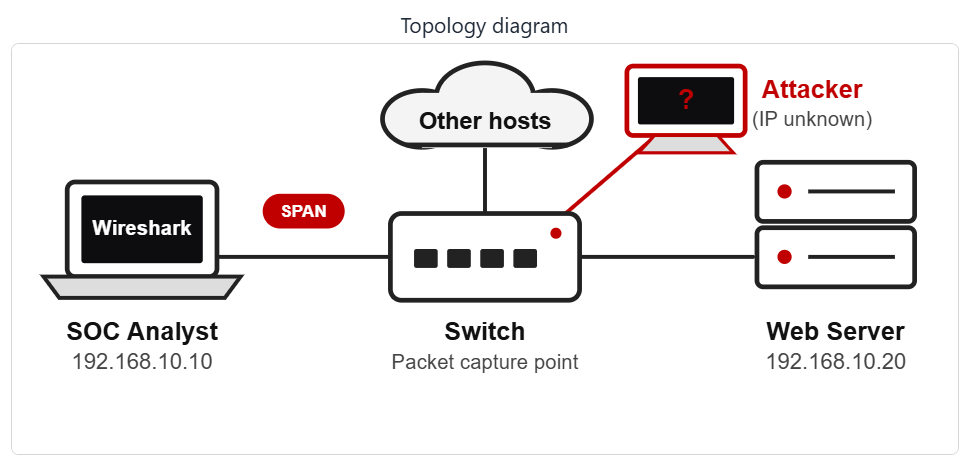

<div align="center">

# 🔐 Cybersecurity - SOC PROJECT - MODULE WIRESHARK (EXTRA)

**🔴 Find an attacker 🔴 Follow TCP Stream 🔴 Hidden data 🔴 Clear text passwords 🔴 Brute force 🔴 VoIP calls**
</div>

<p align="center">
  
  
  
  
  
  
  
  
  
  
  
  
  
  
</p>

---

## 📌 Project Overview

This is the first part (wireshark-lab3) of a Security Operations Center (SOC) project subdivided in 6 wireshark-lab activities. 

Links to the 6 wireshark-lab activities :

- **SOC LAB 1 :** [Wireshark-lab3](wireshark-lab3/wireshark-lab3.md)
- **SOC LAB 2 :** [Wireshark-lab4](https://github.com/PROONGIT/NETWORKWALKS-B084-WK1-EXTRA-PROJECTS/blob/7a9ac0d3c4011f74a971dada7633427f1ced3548/wireshark-lab4/wireshark-lab4.md)
- **SOC LAB 3 :** [Wireshark-lab5](wireshark-lab5/wireshark-lab5.md)
- **SOC LAB 4 :** [Wireshark-lab6](wireshark-lab6/wireshark-lab6.md)
- **SOC LAB 5 :** [Wireshark-lab7](wireshark-lab7/wireshark-lab7.md)
- **SOC LAB 6 :** [Wireshark-lab8](wireshark-lab8/wireshark-lab8.md)

As a SOC analyst in this project, we will investigate 6 live labs. Each lab allows to capture network packets using Wireshark.

We will put into action skills such as Network analysis, Packet inspection, Protocol analysis, Protocol Hierarchy, VoIP, Security mindset, Critical and Analytical thinking, to identify an attacker, follow TCP Stream, rebuid a conversation and read what was sent, find hidden data, usernames, passwords, analyze a VoIP call paquets, play back the call and identify the scammer.

---


## 🎯 Objectives

The main objectives of this project are to:

- To identify the Attacker's IP
- Follow TCP Stream
- Rebuid a conversation and read what was sent
- Find the hidden data
- Find usernames and passwords sent in clear text over HTTP
- Spot the repeated login attempts and find who is guessing passwords (Brut Force Attacker)
- Investigate the capture, play the call and identify the scammer (VoIP call scammer)

---

## 🛡️ Purpose of the Lab

The project provides isolated and controlled environment through the 6 wireshark-labs for Network security learning, SOC skills gaining and authorized Network analysis practices.

It helps gain skills through practical activities :

- Network security
- Wireshark tools
- Packet inspection and analysis
- Protocol Hierarchy
- Protocol analysis
- Follow TCP Stream
- VoIP calls
- Intrusion Detection/Prevention (IDS/IPS)
- Digital Forensics
- Cyber Threat Intelligence (Threat Hunting/Detection/Attribution)
- Critical and Analytical thinking
- Security mindset
- Security-tool experimentation

---

## 🏗️ Lab Architecture




All the 6 labs are based on this topology diagram.

---

# 👁️‍🗨️ Wireshark Lab 3 - Identifying the attacker's IP

## Scenario

You are a SOC analyst. A staff member has reported unusual traffic to your company’s web server. Capture the
packets and analyze them in Wireshark. Find out what type of attack this is and what the attacker’s IP address is.

---

## Task 1. Capture the traffic

I signed in with the username "Student" and password "networkwalks", launched Wireshark from the desktop, then double-click the WiFi interface, traffic packets are captured. The status bar shows Packets: 309.

**Wireshark captured `309` packets.**

---

## Task 2. Show only  the packets that start a TCP connection (only SYN packets)

Establishing a TCP connection typically takes place in three steps, the **three-way handshake**.

TCP Three-Way Handshake

1. SYN
Connection initiation
The client requests the establishment of a connection.

2. SYN + ACK
The server acknowledges receipt and accepts the request.

3. ACK
The client confirms. The connection is established.

The the first two types of packets: SYN and SYN-ACK are the ones that start a TCP connection at the client and the server sides.

The filter **`tcp.flags.syn == 1`** helps display them. Their number is read from the status bar : **`73`** packets.

To display the packets that start a TCP connection :

````
tcp.flags.syn == 1
````

---


**The packets that start a TCP connection are `73` packets.**

---

## Task 3. Find the attacker

We remark that one IP address sends a long block of packets, one after another. We got that IP addrerss suspected and deep our investigation about it.

We displayed the SYN requests from the suspected IP address `192.168.10.66` and compared their number to the total number of the SYN requests.

To display all SYN requests :

````
tcp.flags.syn == 1 && tcp.flags.ack == 0
````

To display SYN requests from the IP address `192.168.10.66` :

````
tcp.flags.syn == 1 && tcp.flags.ack == 0 && ip.src == 192.168.10.66
````

| Indicator          |	Number |
|------------------------|-----|
|Total SYN requests      |	55 |
| From 192.168.10.66	    | 40 |
|From other IP addresses |	15 |

**The share of SYN requests from 192.168.10.66 is `72.7 %`** (40 out of 55 requests). 

---


All the 40 SYN requests are from 192.168.10.66:52311 and target the same IP address 192.168.10.20 on different ports.

**The attacker's IP address is `192.168.10.66`.**

---

## Task 4. Find the target

All the 40 SYN requests are from 192.168.10.66:52311 and target the same IP address **192.168.10.20** on different ports.

**The target's IP address is `192.168.10.20`.**

---

## Task 5. Source port

All the 40 SYN requests are from 192.168.10.66:52311 and target the same IP address **192.168.10.20** on different ports.

**The port number that is the same in every packet is `52311`.**

---

## Task 6. Ports probed 

All the 40 SYN requests from 192.168.10.66:52311 targeted 192.168.10.20 on distinct ports.

**The attacker tried `40` different ports on the target.**

---

## Task 7. Open ports

An open port answers with a SYN, ACK packet.

To display open ports on the target 192.168.10.20 : 

````
tcp.flags.syn == 1 && tcp.flags.ack == 1 && ip.src == 192.168.10.20
````

---


We observe from the "Info" column that the open ports are 22, 80 and 443.

**The expected answer is : `22, 80, 443`.**

---

## Task 8. Reply for closed ports

**A closed port answers with a `RST, ACK` packet.**

---

## Task 9. Closed ports

A closed port answers with a `RST, ACK` packet.

To display closed ports on the target 192.168.10.20 : 

````
ip.src == 192.168.10.20 && tcp.flags.reset == 1 && tcp.flags.ack == 1
````

---


**We can read from that status bar that `37` ports are closed.**

*40 ports were tried and 3 are open, so 37 ports are closed.*

---

## Task 10. Attack type

In a typical TCP SYN scan, the behavior is generally as follow :

1. The attacker sends a SYN packet.

2. The target responds with a SYN-ACK if the port is open.

3. The initiator sends an RST packet to abort the connection without completing the three-way handshake.

If the port is closed, the target responds with an RST-ACK, which terminates the connection.

We examined the attacker's behavior following the three SYN-ACK responses from the target on ports 22, 80, and 443.

To display the RST packets sent by the attacker to the target :

````
ip.src == 192.168.10.66 && ip.dst == 192.168.10.20 && tcp.flags.reset == 1
````

---


The attacker sent RST packets to the target and interrupted the connexions on open ports.

**Identifying the typee of Attack**

Analysis of the TCP packets captured using Wireshark identifies the IP address `192.168.10.66` as the source of intensive network  activity targeting the machine at `192.168.10.20`.

Specifically, 40 SYN packets were sent from the only port 52311 of `192.168.10.66` to 40 distinct ports of `192.168.10.20` at regular intervals of 12.5 milliseconds. The target machine responded with SYN-ACK packets on ports 22, 80, and 443, indicating that these ports were open. The source machine subsequently sent RST packets, terminating the attempts to establish TCP connections.

This behavior is characteristic of a **TCP port scan** known as a "SYN scan" or "TCP half-open scan".


| Element | Result |
|----------|---------|
| Attacker | 192.168.10.66 |
| Target | 192.168.10.20 |
| Identified technique | TCP SYN Scan |
| Regular interval | 12.5 ms |
| Number of SYN packets from .66 | 40 |
| Frequency (packets/second) | 80 |
| Identified open ports | 22, 80, 443 |
| Target responses | SYN-ACK |
| Attacker final behavior | RST |

**Conclusion:** 

**The attack type is a `Port scan`.** The IP address `192.168.10.66` is identified as the source of the port scan, while `192.168.10.20` is the target machine. This activity (such as nmap -sS) is an active network reconnaissance and mapping technique categorized under **`MITRE ATT&CK T1595`** (Active Scanning).

---

# 💡 What I practiced

Through this project, I identified a suspicious activity in the network traffic, investigated to detect the attacker's IP address, the target's IP address, established a table of observations and facts that confirm the effectiveness of the attack  and identified the attack type and its operational technique.

I demonstrated Security Operations Center (SOC) Analysis skills.

The most important skills I demonstrated include:

### 1. Network security

Using Wireshark to capture and analyze network packets helps monitor the network for security purpose. We can then secure what we can see.

### 2. Wireshark tools

I have demonstrated my ability to proficiently use Wireshark tools for **network analysis**, including packet capture and display filtering using the appropriate codes and syntax.

### 3. Packet inspection and analysis

I inspected and analyzed packets and detected traffic anomalies. I also practiced **Protocol analysis**, especialy the TCP **Three-Way Handshake**.

### 4. Intrusion Detection/Prevention (IDS/IPS)

I detected the intrusionn of the attacker in the network, the source address and the nature of the attack. Based on those elements, I can respond to that incident by blocking the attacker's IP address and closing all ports that are not in service. I can also implement measures to prevent future intrusions.

### 5. Digital Forensics

I established the procedure and the technique of the attack. I identified the source and the type of the attack. So I can respond to it and implement prevention measures.

### 6. Cyber Threat Intelligence 

The intrusion of the attacker in the network and the port scan activity constitute threats for the network security. By analyzing the network and detecting earlier the port scan activity, I demonstrated Cyber Threat Intelligence skills, including Threat Hunting, Threat Detection and Threat Attribution.

### 7. Critical and Analytical thinking

I demonstrated Critical and Analytical thinking by putting together many observations and details to build a strong argumentation that clearly establish the effectiveness of an occuring attack, its source, target and identify the attack type.

### 8. Security-tool experimentation

Using different command codes to filter and analyze packets and protocoles with Wireshark is a practical way to experiment and master security tools.

### 9. Security mindset

A security mindset in cybersecurity is a proactive, analytical way of thinking. I demonstrated that mindset throughout this project by using curiosity and setting up a proper strategy to analyze traffic, identify potential activities and establish their effectiveness.

### 10. Documentation

I documented commands / codes, screenshots, tasks and solutions. That is an important part of a professional cybersecurity project.

---

# 🔐 Security & Ethical Use

This project is intended strictly for education purposes only.

>>⚠️ Important: The skills demonstrated in this project must only be used on systems that you own or have explicit permission to test. Do not use the knowledge or the tools to attack unauthorized systems.

---

# 🔗 Tools & Resources

- **Wireshark download:** [https://www.wireshark.org/download.html](https://www.wireshark.org/download.html)
- **Wireshark documentation:** [https://www.wireshark.org/docs/](https://www.wireshark.org/docs/)
- **Wireshark community:** [https://www.wireshark.org/blog/](https://www.wireshark.org/blog/)

---

# 👤 Author

**AZIAGBEDO KOKOU SODJINE**\
Cybersecurity Professional B084

LinkedIn: https://www.linkedin.com/in/kokou-sodjin%C3%A8-aziagbedo-434b2949

---

## 📌 Project Information

**Program Name:** Cybersecurity at Networkwalks | **Week:** 01 | **Project:** SOC PROJECT MODULE WIRESHARK (EXTRA) | **Repository:** GitHub


