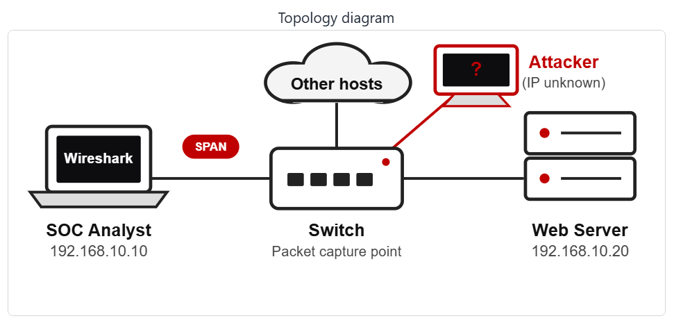
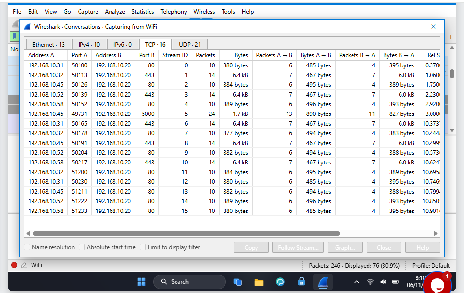
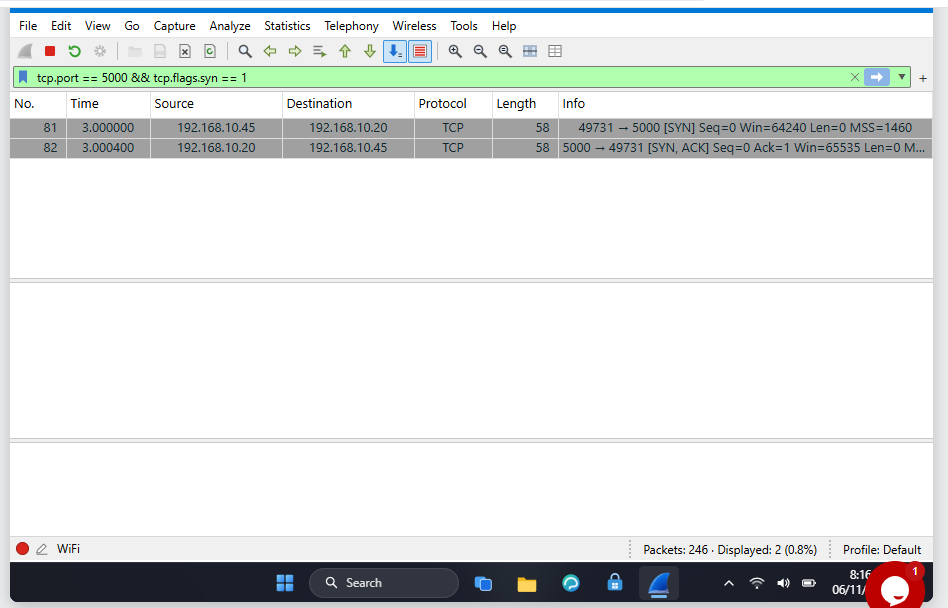
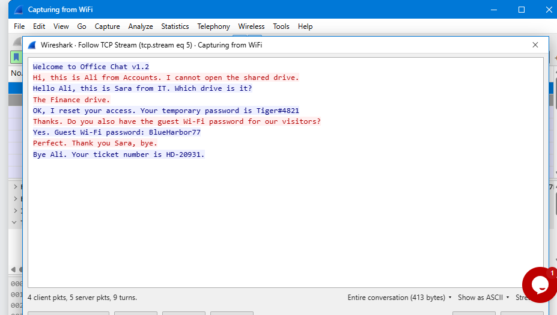

<div align="center">

# 🔐 Cybersecurity - SOC PROJECT - MODULE WIRESHARK (EXTRA)

**🔴 Find an attacker 🔴 Follow TCP Stream 🔴 Hidden data 🔴 Clear text passwords 🔴 Brute force 🔴 VoIP calls**
</div>

<p align="center">
  
  
  
  
  
  
  
  
  
  
  
  
  
  
</p>

---

## 📌 Project Overview

This is the second part (wireshark-lab4) of a Security Operations Center (SOC) project subdivided in 6 wireshark-lab activities. 

Links to the 6 wireshark-lab activities :

- **SOC LAB 1 :** [Wireshark-lab3](/wireshark-lab3/wireshark-lab3.md)
- **SOC LAB 2 :** [Wireshark-lab4](/wireshark-lab4/wireshark-lab4.md)
- **SOC LAB 3 :** [Wireshark-lab5](/wireshark-lab5/wireshark-lab5.md)
- **SOC LAB 4 :** [Wireshark-lab6](/wireshark-lab6/wireshark-lab6.md)
- **SOC LAB 5 :** [Wireshark-lab7](/wireshark-lab7/wireshark-lab7.md)
- **SOC LAB 6 :** [Wireshark-lab8](/wireshark-lab8/wireshark-lab8.md)

As a SOC analyst in this project, we will investigate 6 live labs. Each lab allows to capture network packets using Wireshark.

We will put into action skills such as Network analysis, Packet inspection, Protocol analysis, Protocol Hierarchy, VoIP, Security mindset, Critical and Analytical thinking, to identify an attacker, follow TCP Stream, rebuid a conversation and read what was sent, find hidden data, usernames, passwords, analyze a VoIP call paquets, play back the call and identify the scammer.

---


## 🎯 Objectives

The main objectives of this project are to:

- To identify the Attacker's IP
- Follow TCP Stream
- Rebuid a conversation and read what was sent
- Find the hidden data
- Find usernames and passwords sent in clear text over HTTP
- Spot the repeated login attempts and find who is guessing passwords (Brut Force Attacker)
- Investigate the capture, play the call and identify the scammer (VoIP call scammer)

---

## 🛡️ Purpose of the Lab

The project provides isolated and controlled environment through the 6 wireshark-labs for Network security learning, SOC skills gaining and authorized Network analysis practices.

It helps gain skills through practical activities :

- Network security
- Wireshark tools
- Packet inspection and analysis
- Protocol Hierarchy
- Protocol analysis
- Follow TCP Stream
- VoIP calls
- Intrusion Detection/Prevention (IDS/IPS)
- Digital Forensics
- Cyber Threat Intelligence (Threat Hunting/Detection/Attribution)
- Critical and Analytical thinking
- Security mindset
- Security-tool experimentation

---

## 🏗️ Lab Architecture




All the 6 labs are based on this topology diagram.

---

# 👁️‍🗨️ Wireshark Lab 4 - Follow TCP Stream, Part 1

## Scenario

You are a SOC analyst. Your manager says some staff use an old office chat tool that sends messages in plain text. Capture the traffic and use Follow TCP Stream to read one chat and see what was shared

---

## Task 1. Capture the traffic

I signed in with the username "Student" and password "networkwalks", launched Wireshark from the desktop, then double-click the WiFi interface, traffic packets are captured. The status bar shows Packets: 246.

**Wireshark captured `246` packets.**

---

## Task 2. Find the chat port

We open Statistics -› Conversations and clicked the **TCP tab**.

We remarked that most of the traffic is web traffic on port 80 or 443. One computer also used a plain text office chat tool on a different TCP port that is **`5000`**. 

---



**One conversation uses port `5000`.**

---

## Task 3. Who started the chat? 

The chat uses TCP port **5000**.

We displayed the SYN requests involving the TCP port `5000`. The computer that sends the first SYN packet starts the connection.

Code :

````
tcp.flags.syn == 1 && tcp.port == 5000
````

---



**The IP address that started the chat is `192.168.10.45`.**

---

## Task 4. Stream number

We clicked on the SYN request packet and we followed the chat with **`Analyze > Follow › TCP Stream`**. The title of the window shows tcp.stream eq and the number **`5`**. 

---



**The stream number is `5`.**

---

## Task 5. Size of the chat 

We looked at the bottom bar of the Follow TCP Stream window. The bottom bar shows Entire conversation **413** bytes.

**The entire conversation has `413` bytes.**

---

## Task 6. The first name of who needs help

We can find in the chat conversation that **`Ali`** asked for help.

**The first name of the one who needs help is `Ali`.**

---

## Task 7. The shared drive not opening

We observe in the chat that Ali had issue with “The Finance drive.”

**The expected answer is : `Finance`.**

---

## Task 8. Temporary password

The temporary password is given in the chat.

**The temporary password is `Tiger#4821`.**

---

## Task 9. Guest Wi-Fi password

**We can read also read from the chat that guest wi-fi password is `BlueHarbor77`.**

---

## Task 10. Attack type

**In the Follow TCP Stream window, the colour of the text sent by the computer that started the chat is `Red`.** 

---

# 💡 What I practiced

Through this project, I identified a suspicious activity in the network traffic, investigated to detect the attacker's IP address, the target's IP address, established a table of observations and facts that confirm the effectiveness of the attack  and identified the attack type and its operational technique.

I demonstrated Security Operations Center (SOC) Analysis skills.

The most important skills I demonstrated include:

### 1. Network security

Using Wireshark to capture and analyze network packets helps monitor the network for security purpose. We can then secure what we can see.

### 2. Wireshark tools

I have demonstrated my ability to proficiently use Wireshark tools for **network analysis**, including packet capture and display filtering using the appropriate codes and syntax.

### 3. Packet inspection and analysis

I inspected and analyzed packets and detected traffic anomalies. I also practiced **Protocol analysis**, especialy the TCP **Three-Way Handshake**.

### 4. Intrusion Detection/Prevention (IDS/IPS)

I detected the intrusionn of the attacker in the network, the source address and the nature of the attack. Based on those elements, I can respond to that incident by blocking the attacker's IP address and closing all ports that are not in service. I can also implement measures to prevent future intrusions.

### 5. Digital Forensics

I established the procedure and the technique of the attack. I identified the source and the type of the attack. So I can respond to it and implement prevention measures.

### 6. Cyber Threat Intelligence 

The intrusion of the attacker in the network and the port scan activity constitute threats for the network security. By analyzing the network and detecting earlier the port scan activity, I demonstrated Cyber Threat Intelligence skills, including Threat Hunting, Threat Detection and Threat Attribution.

### 7. Critical and Analytical thinking

I demonstrated Critical and Analytical thinking by putting together many observations and details to build a strong argumentation that clearly establish the effectiveness of an occuring attack, its source, target and identify the attack type.

### 8. Security-tool experimentation

Using different command codes to filter and analyze packets and protocoles with Wireshark is a practical way to experiment and master security tools.

### 9. Security mindset

A security mindset in cybersecurity is a proactive, analytical way of thinking. I demonstrated that mindset throughout this project by using curiosity and setting up a proper strategy to analyze traffic, identify potential activities and establish their effectiveness.

### 10. Documentation

I documented commands / codes, screenshots, tasks and solutions. That is an important part of a professional cybersecurity project.

---

# 🔐 Security & Ethical Use

This project is intended strictly for education purposes only.

>>⚠️ Important: The skills demonstrated in this project must only be used on systems that you own or have explicit permission to test. Do not use the knowledge or the tools to attack unauthorized systems.

---

# 🔗 Tools & Resources

- **Wireshark download:** [https://www.wireshark.org/download.html](https://www.wireshark.org/download.html)
- **Wireshark documentation:** [https://www.wireshark.org/docs/](https://www.wireshark.org/docs/)
- **Wireshark community:** [https://www.wireshark.org/blog/](https://www.wireshark.org/blog/)

---

# 👤 Author

**AZIAGBEDO KOKOU SODJINE**\
Cybersecurity Professional B084

LinkedIn: https://www.linkedin.com/in/kokou-sodjin%C3%A8-aziagbedo-434b2949

---

## 📌 Project Information

**Program Name:** Cybersecurity at Networkwalks | **Week:** 01 | **Project:** SOC PROJECT MODULE WIRESHARK (EXTRA) | **Repository:** GitHub


