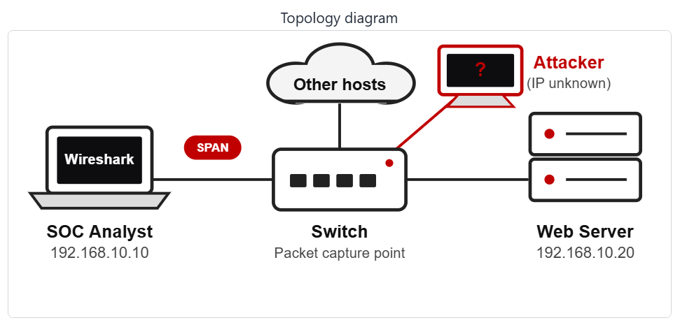
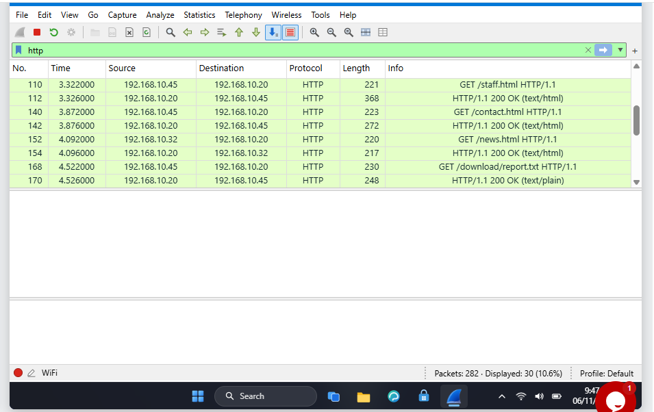
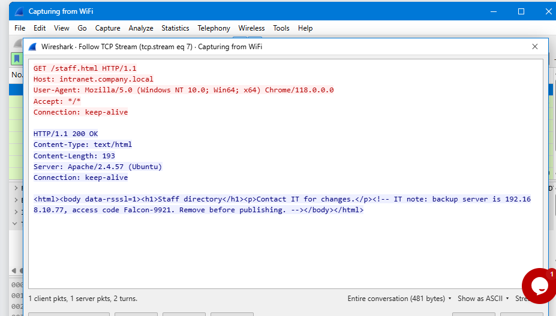
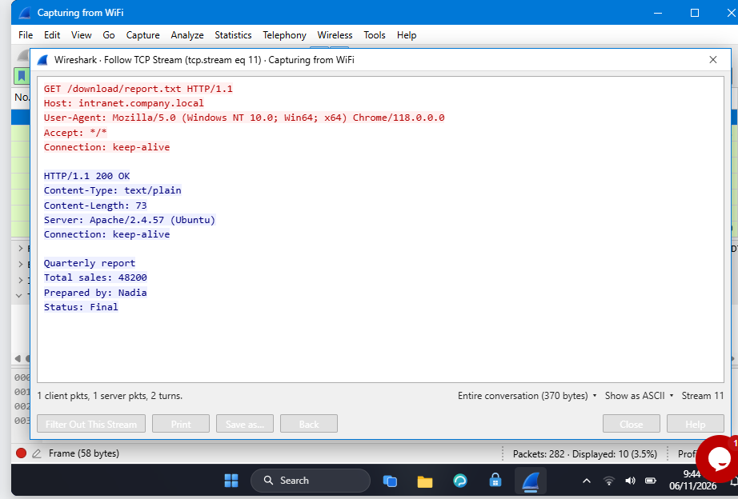

# 🔐 Cybersecurity - SOC PROJECT - MODULE WIRESHARK (EXTRA)

**🔴 Find an attacker 🔴 Follow TCP Stream 🔴 Hidden data 🔴 Clear text passwords 🔴 Brute force 🔴 VoIP calls**

  
  
  
  
  
  
  
  
  
  
  
  
  
  

---

## 📌 Project Overview

This is the third part (wireshark-lab5) of a Security Operations Center (SOC) project subdivided in 6 wireshark-lab activities. 

Links to the 6 wireshark-lab activities :

- **SOC LAB 1 :** [Wireshark-lab3](/wireshark-lab3/wireshark-lab3.md)
- **SOC LAB 2 :** [Wireshark-lab4](/wireshark-lab4/wireshark-lab4.md)
- **SOC LAB 3 :** [Wireshark-lab5](/wireshark-lab5/wireshark-lab5.md)
- **SOC LAB 4 :** [Wireshark-lab6](/wireshark-lab6/wireshark-lab6.md)
- **SOC LAB 5 :** [Wireshark-lab7](/wireshark-lab7/wireshark-lab7.md)
- **SOC LAB 6 :** [Wireshark-lab8](/wireshark-lab8/wireshark-lab8.md)

As a SOC analyst in this project, we will investigate 6 live labs. Each lab allows to capture network packets using Wireshark.

We will put into action skills such as Network analysis, Packet inspection, Protocol analysis, Protocol Hierarchy, VoIP, Security mindset, Critical and Analytical thinking, to identify an attacker, follow TCP Stream, rebuid a conversation and read what was sent, find hidden data, usernames, passwords, analyze a VoIP call paquets, play back the call and identify the scammer.

---

## 🎯 Objectives

The main objectives of this project are to:

- Identify the Attacker's IP
- Follow TCP Stream
- Rebuild a conversation and read what was sent
- Find the hidden data
- Find usernames and passwords sent in clear text over HTTP
- Spot the repeated login attempts and find who is guessing passwords (Brut Force Attacker)
- Investigate the capture, play the call and identify the scammer (VoIP call scammer)

---

## 🛡️ Purpose of the Lab

The project provides isolated and controlled environment through the 6 wireshark-labs for Network security learning, SOC skills gaining and authorized Network analysis practices.

It helps gain skills through practical activities :

- Network security
- Wireshark tools
- Packet inspection and analysis
- Protocol Hierarchy
- Protocol analysis
- Follow TCP Stream
- VoIP calls
- Intrusion Detection/Prevention (IDS/IPS)
- Digital Forensics
- Cyber Threat Intelligence (Threat Hunting/Detection/Attribution)
- Critical and Analytical thinking
- Security mindset
- Security-tool experimentation

---

## 🏗️ Lab Architecture

All the 6 labs are based on this topology diagram.

---

# 👁️‍🗨️ Wireshark Lab 5 - Follow TCP Stream, Part 2

## Scenario

A staff member browsed the company intranet. An admin thinks someone left a secret inside one of the web pages. Capture the traffic and use Follow TCP Stream to find the hidden text.

---

## Task 1. Capture the traffic

I signed in with the username "Student" and password "networkwalks", launched Wireshark from the desktop, then double-click the WiFi interface, traffic packets are captured. The status bar shows Packets: 282.

**Wireshark captured `282` packets.**

---

## Task 2. Find the page

We filtered the packets with **`http`** and displayed the web activities. We followed the streams of the pages and observed that the page **`/staff.html`** had a hidden info.

---

---

**The page with a hidden note is `/staff.htm`.**

---

## Task 3. Where is it hidden

We remark that there is a note placed in comments <!-- --> and called "IT note".

**The hidden note is in `An HTML comment`.** 

---

## Task 4. Find the stream

Following the TCP stream related to the "/staff.html" page, we can see above the window **tcp.stream eq 7** and at the bottom of the same window, we read **Stream 7**.

**The stream is the stream number `7`.**

---

## Task 5. The code word

**In the comment, the access code word is `Falcon-9921`.**

---

## Task 6. The backup server's IP address

**In the comment, the backup server's IP address is `192.168.10.77`.**

---

## Task 7. The way the text traveled

**The way the text traveled is : `Server to client`.**

---

## Task 8. Status code

We can read "HTTP/1.1 200 OK".

**The HTTP status code sent is `200`.**

---

## Task 9. The downloaded folder

The `http` filter revealed a visited page packet having in the "Info" column **GET /download/report.txt**

**The file name is `report.txt`.**

---

## Task 10.  Who prepared the report?

We followed up the TCP stream related to the downloading packet. 

We read **Prepared by : Nadia**.

---

**The one who prepared the report is `Nadia`.**

---

# 💡 What I practiced

Through this project, I identified unsecure web activities in the network traffic and find critical hidden data, including a backup server's IP address, password and a downloaded report file.

I demonstrated Security Operations Center (SOC) Analysis skills.

The most important skills I demonstrated include:

### 1. Network security

Using Wireshark to capture and analyze network packets helps monitor the network for security purpose. We can then secure what we can see.

### 2. Wireshark tools

I have demonstrated my ability to proficiently use Wireshark tools for network analysis, including packet capture, display filtering using the appropriate codes and syntax and TCP Stream following, finding critical hidden data such as a backup server's IP address, password and a downloaded report file.

### 3. Packet inspection and analysis

I inspected and analyzed packets and detected unsecured web activities. I also practiced Packet analysis, especialy TCP Stream following to find critical hidden data.

### 4. Network sniffing

I analyzed the network traffic, detected unsecure web activities and get a server's IP address, password and the content of a text file.

### 5. Cyber Threat Intelligence 

The unsecured web activities represent threats for the network security. By analyzing the network and detecting earlier the unsecure web activityies, I demonstrated Cyber Threat Intelligence skills, including Threat Hunting and Threat Detection.

### 6. Critical and Analytical thinking

I demonstrated Critical and Analytical thinking by implementing an effective procedure to detect the unsecure web activities and get the hidden data.

### 7. Security-tool experimentation

Using different command codes to filter and analyze packets and protocoles with Wireshark is a practical way to experiment and master security tools.

### 8. Security mindset

A security mindset in cybersecurity is a proactive, analytical way of thinking. I demonstrated that mindset throughout this project by using curiosity and setting up a proper strategy to analyze traffic, identify unsecure activities and establish their effectiveness.

### 9. Documentation

I documented commands / codes, screenshots, tasks and solutions. That is an important part of a professional cybersecurity project.

---

# 🔐 Security & Ethical Use

This project is intended strictly for education purposes only.

>>⚠️ Important: The skills demonstrated in this project must only be used on systems that you own or have explicit permission to test. Do not use the knowledge or the tools to attack unauthorized systems.

---

# 🔗 Tools & Resources

- **Wireshark download:** [https://www.wireshark.org/download.html](https://www.wireshark.org/download.html)
- **Wireshark documentation:** [https://www.wireshark.org/docs/](https://www.wireshark.org/docs/)
- **Wireshark community:** [https://www.wireshark.org/blog/](https://www.wireshark.org/blog/)

---

# 👤 Author

**AZIAGBEDO KOKOU SODJINE**\
Cybersecurity Professional B084

LinkedIn: https://www.linkedin.com/in/kokou-sodjin%C3%A8-aziagbedo-434b2949

---

## 📌 Project Information

**Program Name:** Cybersecurity at Networkwalks | **Week:** 01 | **Project:** SOC PROJECT MODULE WIRESHARK (EXTRA) | **Repository:** GitHub

