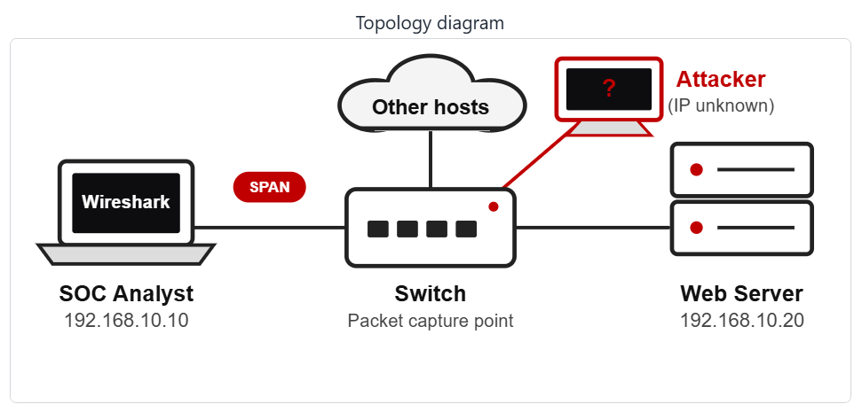
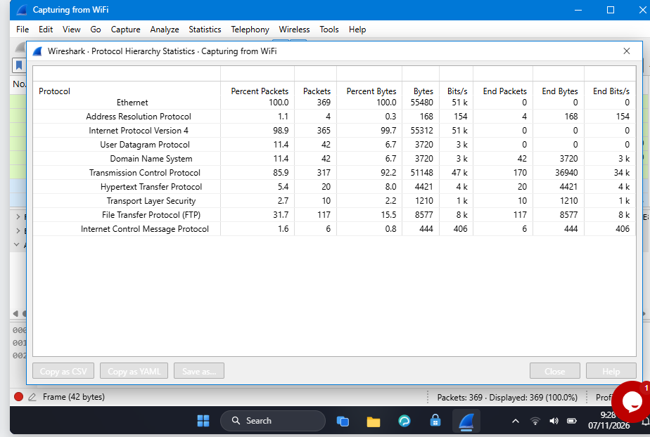
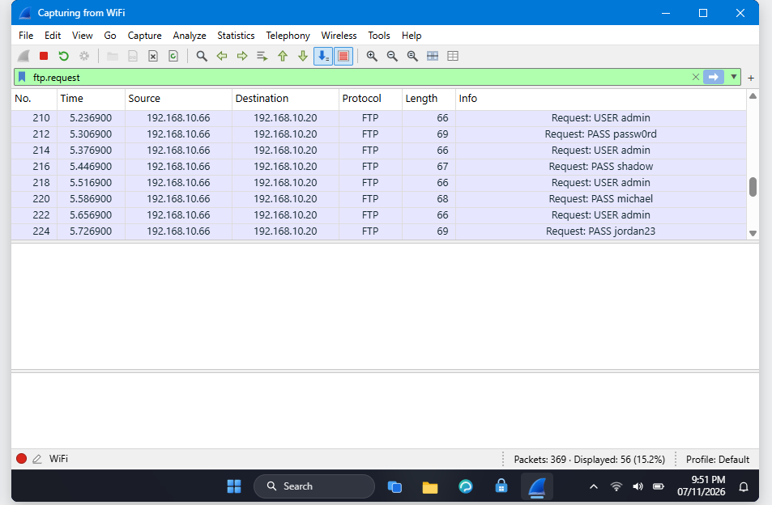
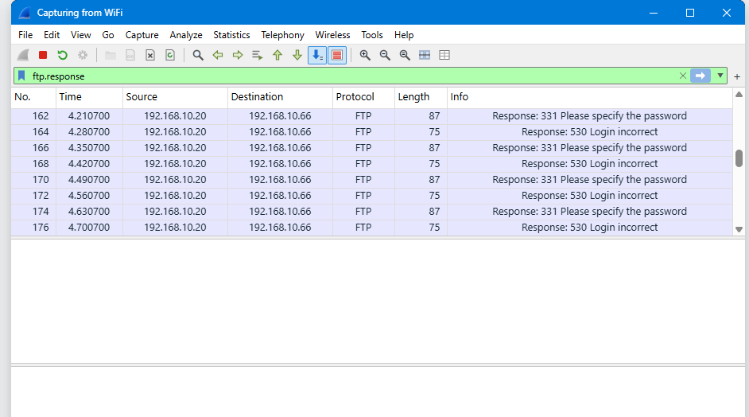
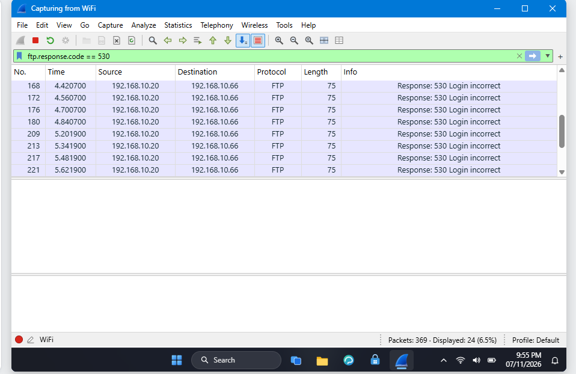
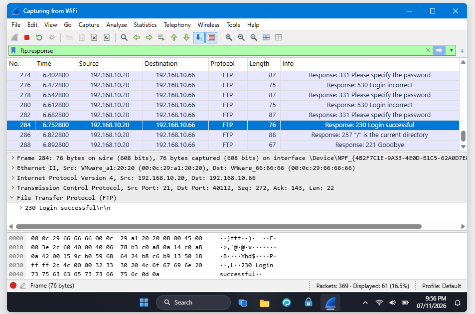
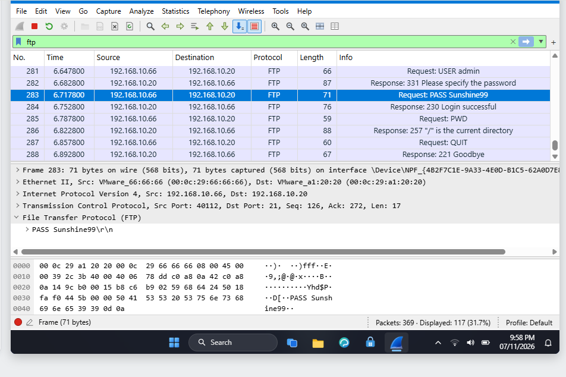

<div align="center">

# 🔐 Cybersecurity - SOC PROJECT - MODULE WIRESHARK (EXTRA)

**🔴 Find an attacker 🔴 Follow TCP Stream 🔴 Hidden data 🔴 Clear text passwords 🔴 Brute force 🔴 VoIP calls**
</div>

<p align="center">
  
  
  
  
  
  
  
  
  
  
  
  
  
  
</p>

---

## 📌 Project Overview

This is the fifth part (wireshark-lab7) of a Security Operations Center (SOC) project subdivided in 6 wireshark-lab activities. 

Links to the 6 wireshark-lab activities :

- **SOC LAB 1 :** [Wireshark-lab3](/wireshark-lab3/wireshark-lab3.md)
- **SOC LAB 2 :** [Wireshark-lab4](/wireshark-lab4/wireshark-lab4.md)
- **SOC LAB 3 :** [Wireshark-lab5](/wireshark-lab5/wireshark-lab5.md)
- **SOC LAB 4 :** [Wireshark-lab6](/wireshark-lab6/wireshark-lab6.md)
- **SOC LAB 5 :** [Wireshark-lab7](/wireshark-lab7/wireshark-lab7.md)
- **SOC LAB 6 :** [Wireshark-lab8](/wireshark-lab8/wireshark-lab8.md)

As a SOC analyst in this project, we will investigate 6 live labs. Each lab allows to capture network packets using Wireshark.

We will put into action skills such as Network analysis, Packet inspection, Protocol analysis, Protocol Hierarchy, VoIP, Security mindset, Critical and Analytical thinking, to identify an attacker, follow TCP Stream, rebuid a conversation and read what was sent, find hidden data, usernames, passwords, analyze a VoIP call paquets, play back the call and identify the scammer.

---


## 🎯 Objectives

The main objectives of this project are to:

- Identify the Attacker's IP
- Follow TCP Stream
- Rebuild a conversation and read what was sent
- Find the hidden data
- Find usernames and passwords sent in clear text over HTTP
- Spot the repeated login attempts and find who is guessing passwords (Brut Force Attacker)
- Investigate the capture, play the call and identify the scammer (VoIP call scammer)
---

## 🛡️ Purpose of the Lab

The project provides isolated and controlled environment through the 6 wireshark-labs for Network security learning, SOC skills gaining and authorized Network analysis practices.

It helps gain skills through practical activities :

- Network security
- Wireshark tools
- Packet inspection and analysis
- Protocol Hierarchy
- Protocol analysis
- Follow TCP Stream
- VoIP calls
- Intrusion Detection/Prevention (IDS/IPS)
- Digital Forensics
- Cyber Threat Intelligence (Threat Hunting/Detection/Attribution)
- Critical and Analytical thinking
- Security mindset
- Security-tool experimentation

---

## 🏗️ Lab Architecture




All the 6 labs are based on this topology diagram.

---

# 👁️‍🗨️ Wireshark Lab 7 - Catch The Bruce Force Attacker

## Scenario

 The FTP server owner reports many failed sign-ins in the last minutes. Capture the traffic, find who is guessing passwords and whether the attacker got in.

---

## Task 1. Capture the traffic

I signed in with the username "Student" and password "networkwalks", launched Wireshark from the desktop, then double-click the WiFi interface, traffic packets are captured. The status bar shows Packets: 369.

**Wireshark captured `369` packets.**

---

## Task 2. The protocol

We displayed the protocol hierarchy by doing Statistics -› Protocol Hierarchy.

The FTP protocol shows the most intensive activities : **31,7 % of packets (117 packets) and 15,5 % of Bytes**.

---



**The protocol on which occured many failed sign-ins is `FTP`.**

---

## Task 3. The target 

We displayed all the FTP request packets and checked their destination IP address.

To display all FTP requests :

````
ftp.request
````

---



All the FTP requests are from 192.168.10.66 and target the same IP address 192.168.10.20.

**The target's IP address is `192.168.10.20`.**

---

## Task 4. The attacker

All the FTP requests are from **192.168.10.66** and target the same IP address 192.168.10.20.

**The attacker's IP address is `192.168.10.66`.**

---

## Task 5. The username

**The username is `admin`.**

---

## Task 6. FTP reply code for “Login incorrect”

We displayed all the FTP response packets and checked the code for "Login incorrect".

To display all FTP response packets :

````
ftp.response
````

---



**The code for "Login incorrect" is `530`.**

---

## Task 7. The number of failed logins

We displayed only failed login packets. 

To display failed login packets : 

````
ftp.response.code == 530
````

---



We observe from the status bar that their number is **24**.

**The number of failed logins is `24`.**

---

## Task 8. FTP reply code for a successful login

We displayed all the FTP response packets and checked the code for "Login successful".

To display all FTP response packets :

````
ftp.response
````

---



**The code for "Login successful" is `230`.**

---

## Task 9. The password that was successful

The successful login packet is packet n° 284. The packet just before is n° 283 and it shows the used password.

To display ftp packets : 

````
ftp
````

---



**The successful password is `Sunshine99`.**

---

## Task 10. Attack type

We observed an attack where many login attempts on one target failed until one login attempt was successful. The attacker tried different passwords.

**The attack type is `Brute Force`.**

---

# 💡 What I practiced

Through this project, I identified a suspicious activity in the network traffic, investigated to detect the attacker's IP address, the target's IP address, established a set of observations and facts that confirm the effectiveness of the attack and identified the attack type and its operational technique.

I demonstrated Security Operations Center (SOC) Analysis skills.

The most important skills I demonstrated include:

### 1. Network security

Using Wireshark to capture and analyze network packets helps monitor the network for security purpose. We can then secure what we can see.

### 2. Wireshark tools

I have demonstrated my ability to proficiently use Wireshark tools for **network analysis**, including packet capture and display filtering using the appropriate codes and syntax.

### 3. Packet inspection and analysis

I inspected and analyzed packets and detected suspicious activities on a FTP server. I also practiced **Protocol analysis**, especialy the **FTP protocol**.

### 4. Network sniffing

I analyzed the network traffic, detected malicious activities and get critical data such as username, passwords and IP addresses.

### 5. Intrusion Detection/Prevention (IDS/IPS)

I detected the intrusion of the attacker in the network, the source address and the nature of the attack. Based on those elements, I can respond to that incident by changing the login credentials, blocking the attacker's IP address and closing all ports that are not in service. I can also implement other security measures to prevent future intrusions.

### 6. Digital Forensics

I established the procedure and the technique of the attack. I identified the source and the type of the attack. So I can respond to it and implement prevention measures.

### 7. Cyber Threat Intelligence 

The intrusion of the attacker in the network and the force brute attack activity constitute threats for the network security. By analyzing the network and detecting earlier the force brute attack, I demonstrated Cyber Threat Intelligence skills, including Threat Hunting, Threat Detection and Threat Attribution.

### 8. Critical and Analytical thinking

I demonstrated Critical and Analytical thinking by putting together many observations and details to build a strong argumentation that clearly establish the effectiveness of an occuring attack, its source, target and identify the attack type.

### 9. Security-tool experimentation

Using different command codes to filter and analyze packets and protocoles with Wireshark is a practical way to experiment and master security tools.

### 10. Security mindset

A security mindset in cybersecurity is a proactive, analytical way of thinking. I demonstrated that mindset throughout this project by using curiosity and setting up a proper strategy to analyze traffic, identify suspicious activities and establish their effectiveness.

### 11. Documentation

I documented commands / codes, screenshots, tasks and solutions. That is an important part of a professional cybersecurity project.

---

# 🔐 Security & Ethical Use

This project is intended strictly for education purposes only.

>>⚠️ Important: The skills demonstrated in this project must only be used on systems that you own or have explicit permission to test. Do not use the knowledge or the tools to attack unauthorized systems.

---

# 🔗 Tools & Resources

- **Wireshark download:** [https://www.wireshark.org/download.html](https://www.wireshark.org/download.html)
- **Wireshark documentation:** [https://www.wireshark.org/docs/](https://www.wireshark.org/docs/)
- **Wireshark community:** [https://www.wireshark.org/blog/](https://www.wireshark.org/blog/)

---

# 👤 Author

**AZIAGBEDO KOKOU SODJINE**\
Cybersecurity Professional B084

LinkedIn: https://www.linkedin.com/in/kokou-sodjin%C3%A8-aziagbedo-434b2949

---

## 📌 Project Information

**Program Name:** Cybersecurity at Networkwalks | **Week:** 01 | **Project:** SOC PROJECT MODULE WIRESHARK (EXTRA) | **Repository:** GitHub


